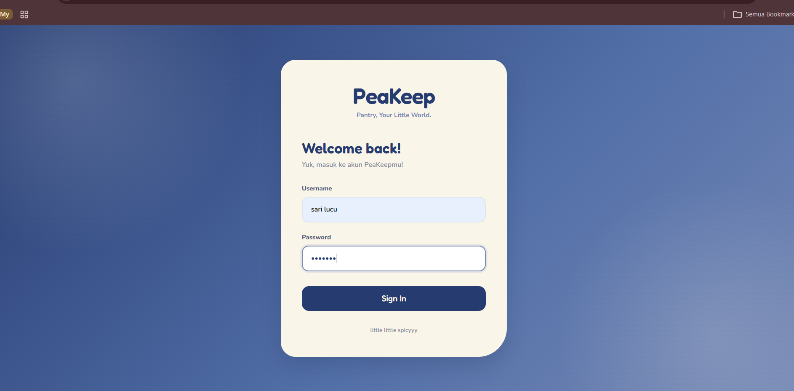
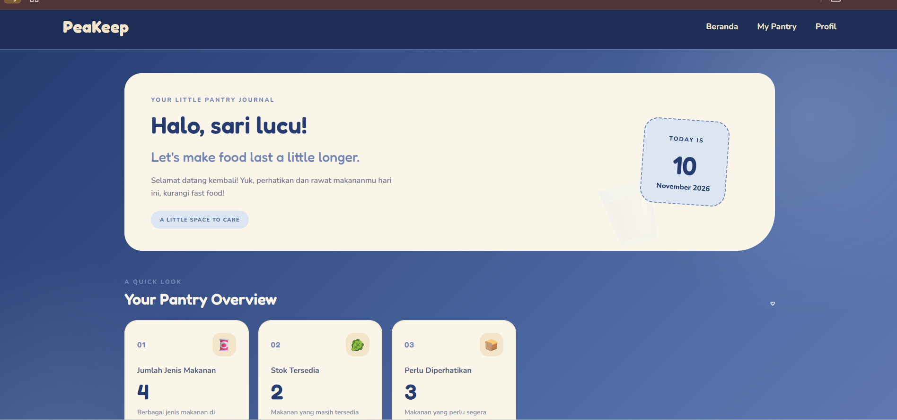
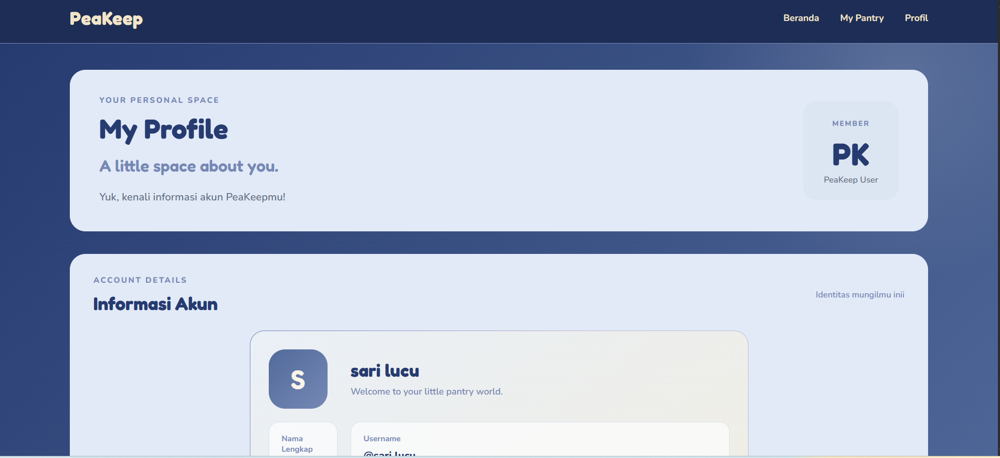
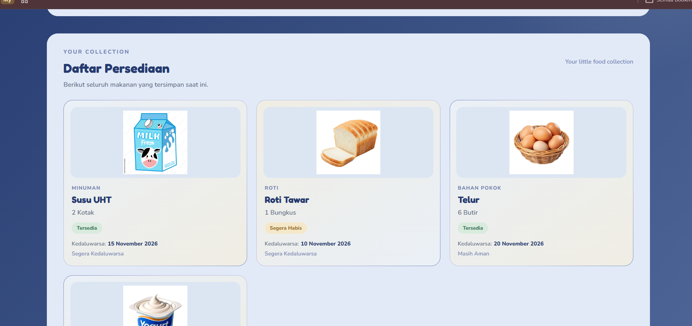

# PeaKeep 🥛 
Your Pantry, Your Little World

PeaKeep adalah website pengelolaan persediaan bahan makanan pribadi yang dirancang untuk membantu pengguna memantau dan mengorganisasi bahan makanan di rumah.

Website ini dikembangkan menggunakan Laravel dengan pendekatan Model-View-Controller (MVC) dan Blade Template sebagai bagian dari proyek Ujian Tengah Semester (UTS) mata kuliah Pemrograman Web.

Mengusung tema *playful little pantry* dengan nuansa Sea Bloom, PeaKeep menghadirkan tampilan modern, playful, dan ramah pengguna agar kegiatan memantau persediaan bahan makanan terasa lebih praktis.

**Tema pengelolaan:** Pengelolaan persediaan bahan makanan (*personal pantry management*), meliputi pemantauan jumlah persediaan, kategori, status ketersediaan, dan tanggal kedaluwarsa.

**Dibuat oleh:** Sari Oktaviani Pane — NIM 252410102068

---

## 📸 Tampilan Website

| Login | Dashboard |
|:---:|:---:|
|  |  |

| My Profile | My Pantry |
|:---:|:---:|
|  |  |

---

## ✨ Fitur Utama

- **Login:** Halaman masuk untuk pengguna sebelum mengakses fitur utama PeaKeep. Login menggunakan simulasi tanpa autentikasi database.
- **Dashboard:** Menampilkan sapaan pengguna, informasi tanggal, ringkasan persediaan, kutipan, pengingat, dan daftar bahan makanan yang perlu diperhatikan.
- **My Profile:** Menampilkan informasi akun berupa nama dan username pengguna yang sedang digunakan.
- **My Pantry (Pengelolaan):** Menampilkan daftar bahan makanan beserta gambar, kategori, jumlah persediaan, status ketersediaan, dan informasi kedaluwarsa.

---

## 🚀 Teknologi yang Digunakan

| Teknologi | Kegunaan |
|---|---|
| Laravel 12 | Framework pengembangan aplikasi web |
| PHP | Bahasa pemrograman sisi server |
| Blade Template | Menyusun tampilan halaman menggunakan template Laravel |
| HTML | Membuat struktur halaman website |
| CSS | Mengatur desain, warna, tata letak, dan responsivitas |
| JavaScript | Mendukung interaksi pada navigasi website |

---

## 🗂️ Struktur File Utama

| File | Fungsi |
|---|---|
| `routes/web.php` | Mengatur alamat URL dan menghubungkannya dengan Controller |
| `app/Http/Controllers/PageController.php` | Mengelola data dan menyiapkan data yang dikirimkan ke View |
| `resources/views/layouts/app.blade.php` | Layout utama website menggunakan `@yield` dan `@stack` |
| `resources/views/login.blade.php` | Halaman login |
| `resources/views/dashboard.blade.php` | Halaman dashboard |
| `resources/views/pengelolaan.blade.php` | Halaman pengelolaan bahan makanan |
| `resources/views/profile.blade.php` | Halaman profil pengguna |
| `resources/views/components/navbar.blade.php` | Komponen navigasi website |
| `resources/views/components/footer.blade.php` | Komponen footer website |
| `public/css/` | Menyimpan file CSS untuk desain website |
| `public/js/` | Menyimpan file JavaScript |
| `public/foods/` | Menyimpan gambar bahan makanan |
| `public/fonts/` | Menyimpan font lokal yang digunakan website |

---

## ⚙️ Instalasi dan Setup

Berikut langkah-langkah untuk menjalankan PeaKeep di komputer lokal.

**1. Clone repository**

```bash
git clone https://github.com/sari-pane/UTS_PWEB_252410102068.git
```

**2. Masuk ke direktori project**

```bash
cd UTS_PWEB_252410102068
```

**3. Install dependency Laravel**

```bash
composer install
```

**4. Salin file environment**

Buat file `.env` berdasarkan `.env.example`.

**5. Generate application key**

```bash
php artisan key:generate
```

**6. Jalankan server Laravel**

```bash
php artisan serve
```

**7. Buka website**

Akses alamat berikut melalui browser:

```text
http://127.0.0.1:8000
```

---

## 🔄 Alur Penggunaan Website

1. Pengguna membuka website dan masuk melalui halaman Login.
2. Setelah login, pengguna diarahkan menuju Dashboard.
3. Pengguna dapat melihat ringkasan persediaan dan informasi bahan makanan.
4. Pengguna dapat membuka My Profile untuk melihat informasi akun.
5. Pengguna dapat membuka My Pantry untuk melihat daftar dan informasi persediaan bahan makanan.

---

## 📝 Catatan Implementasi

- Website dikembangkan menggunakan pendekatan MVC (Model-View-Controller) pada Laravel.
- Data contoh pengguna dan bahan makanan dikelola melalui Controller dan dikirimkan ke View.
- Data bahan makanan disimpan dalam bentuk array statis di `PageController`, bukan melalui database.
- Website ini merupakan simulasi pengelolaan persediaan dan tidak menerapkan operasi CRUD maupun penyimpanan data permanen.
- Informasi pengguna diteruskan melalui request parameter sesuai alur aplikasi.

---

<p align="center">

**PeaKeep — Your Pantry, Your Little World.**

Made with care for Pemrograman Web UTS.

</p>
